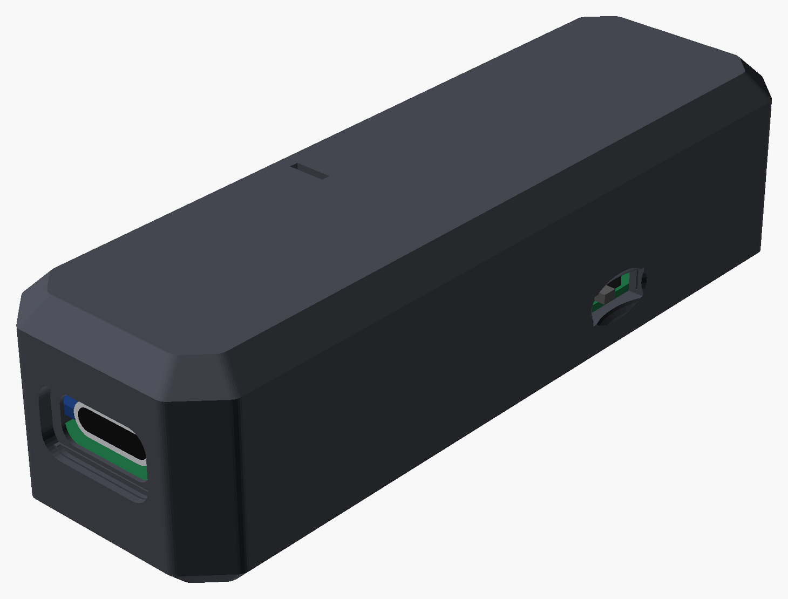
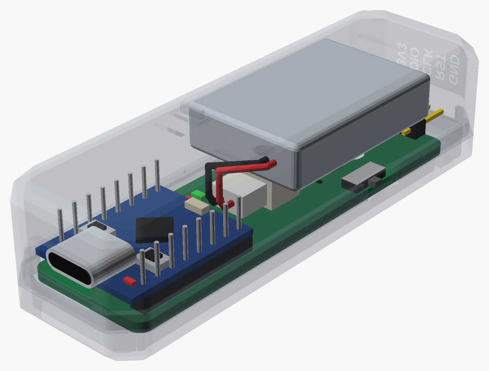
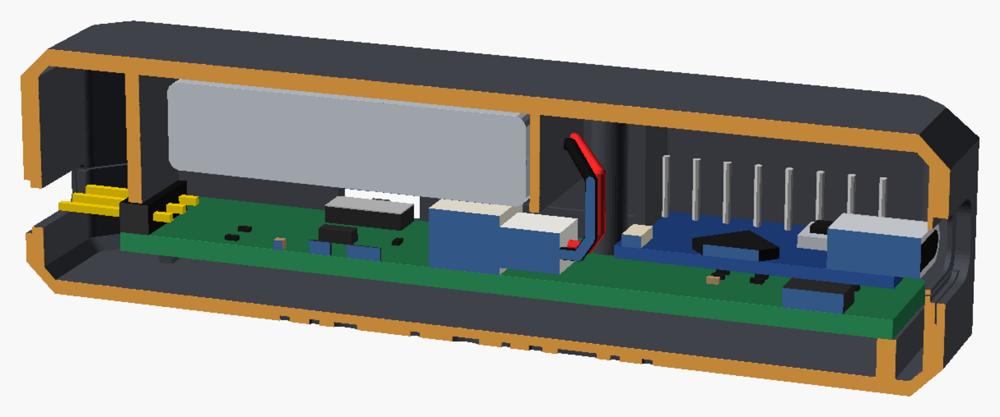
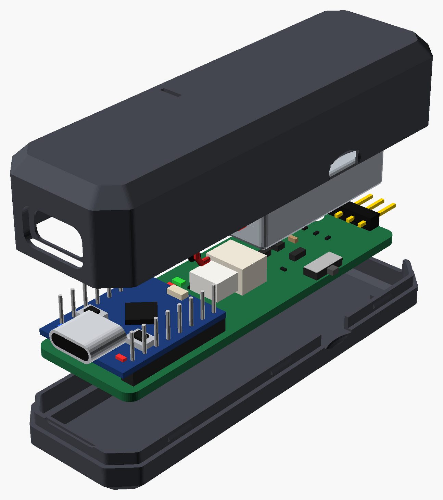
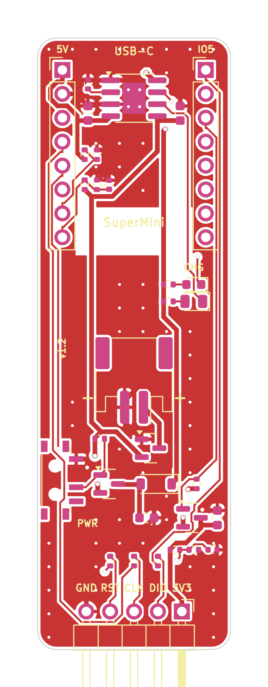
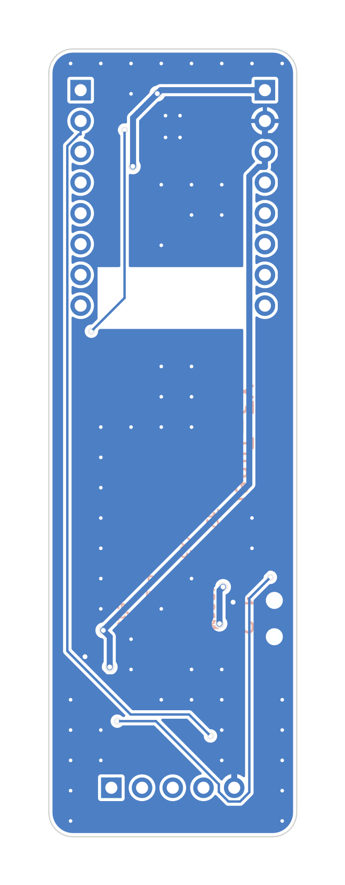
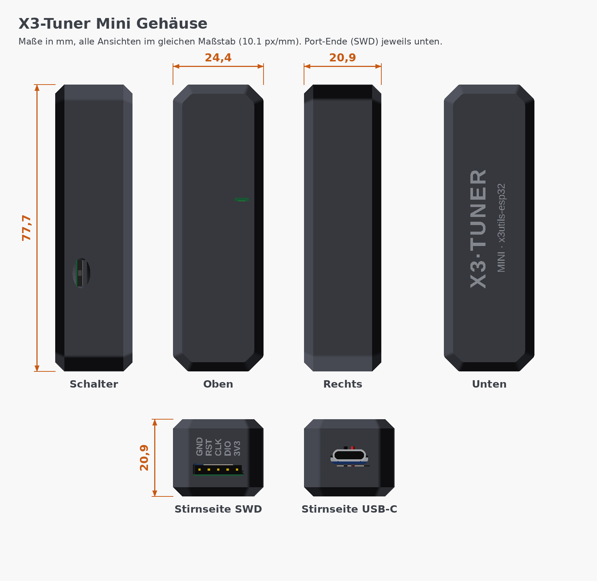

# X3-Tuner Mini – Trägerplatine für das ESP32-C3 SuperMini

Die günstige Variante des X3-Tuners, als schmaler **Stick** mit 3D-Druck-Gehäuse
(ca. 78 × 24 × 21 mm). Den ESP32 kaufst du als fertiges **ESP32-C3 SuperMini**
(ca. 1,80 €) und **steckst ihn einfach auf**. Das SuperMini hat **keine
eingelöteten Stifte** – die sitzen auf der Trägerplatine, die Fabrik lötet sie
an, und das SuperMini wird draufgesteckt und vom Deckel festgehalten.
Die Trägerplatine bringt alles mit, was dem SuperMini fehlt:

- 1S-LiPo-Akku mit TP4056-Ladeschaltung, geladen über die USB-C-Buchse des SuperMini
- Verpolschutz für den Akku (viele Billig-Akkus haben vertauschte Kabel)
- Ein/Aus-Schiebeschalter
- schaltbare 3,3-V-Versorgung für die Scooter-VCU (Power-Race per Firmware)
- Messung von Akku, USB und VCU-Spannung
- SWD-Stiftleiste zum Scooter

**Du lötest nichts.** Die Fabrik bestückt alle Teile, auch die beiden
Stiftleisten für das SuperMini und die SWD-Stiftleiste.

> [!NOTE]
> **Geschlossenes Gehäuse, geschützte Firmware.** Es gibt keine Öffnungen für
> die RESET-/BOOT-Taster: Niemand kommt von außen an das SuperMini. Die Firmware
> kann so eingestellt werden, dass sie **nicht ausgelesen oder über USB
> umgeflasht** werden kann und Updates **nur per WLAN über deine App** laufen –
> siehe [SECURITY.md](SECURITY.md).

| Gehäuse | Durchsichtig (Aufbau) |
|---|---|
|  |  |
| **Schnitt** | **Explosionsansicht** |
|  |  |

| Platine oben | Platine unten |
|---|---|
|  |  |

[Schaltplan (PDF)](docs/x3carrier-schematic.pdf) ·
[Bestückungsplan (PDF)](docs/x3carrier-assembly.pdf) ·
[Fertigungsdaten](production/) ·
[Gehäuse (STL)](case/stl/)

> [!IMPORTANT]
> **Status: Design fertig (Rev. 1.2, Stick mit Stiftleisten), noch nicht
> gefertigt.** DRC: 0 Fehler, 0 offene Verbindungen, der Schaltplan wird
> automatisch gegen die Netzliste geprüft. Das Gehäuse ist gegen Platine,
> SuperMini und Akku auf Kollisionen geprüft. **Eine Sache fehlt noch:** die
> LCSC-Nummer der 1×8-Stiftleiste – siehe [Bestellen](#bestellen). Vor der
> Bestellung bitte [diese Punkte](#vor-der-bestellung-prüfen) prüfen.

## Was drauf ist

| Block | Lösung |
|---|---|
| Platine | 20,5 × 65 mm, 2 Lagen, alle Teile oben |
| ESP32 | ESP32-C3 SuperMini, auf 2 × 1×8-**Stiftleisten** (2,54 mm) aufgesteckt und vom Deckel niedergehalten, USB-C an der vorderen Kante |
| Laden | TP4056, ca. 235 mA, gespeist aus dem 5V-Pin des SuperMini (= USB VBUS). LEDs: rot = lädt, grün = voll |
| Akku | 1S LiPo **mit eigener Schutzschaltung**, JST-PH-2.0-Buchse, Verpolschutz (P-MOSFET Q3) |
| Ein/Aus | Schiebeschalter MSK12C02. Er schaltet nur das Gate des P-MOSFET Q1 und trägt keinen Laststrom |
| Akkubetrieb | Akku → Q3 → Q1 → Schottky-Diode D1 → 5V-Pin → 3,3-V-Regler des SuperMini |
| VCU-Versorgung | P-MOSFET Q2 aus 3V3 des SuperMini, GPIO7 low = an, beim Booten aus |
| SWD | gewinkelte 1×5-Stiftleiste an der hinteren Kante (3V3 · DIO · CLK · RST · GND), 100 Ω Serienwiderstände |

### Belegung des SuperMini

Ansicht von oben, USB-C nach oben. Pin 1 jeder Reihe ist der Pin neben USB-C.
Auf der Platine zeigt USB-C zur vorderen Kante (Aufdruck „USB-C“), die
5V-Reihe liegt dann links (Aufdruck „5V“).

| Linke Reihe | Funktion | Rechte Reihe | Funktion |
|---|---|---|---|
| 5V | Akku / Lader (= USB VBUS) | GPIO5 | SWDIO |
| GND | GND | GPIO6 | nRST |
| 3V3 | 3,3 V für die VCU | GPIO7 | VCU-Versorgung ein (low) |
| GPIO4 | SWCLK | GPIO8 | blaue LED des SuperMini (Status, im Gehäuse verdeckt) |
| GPIO3 | VCU-Spannung messen | GPIO9 | BOOT-Taster (im Gehäuse nicht erreichbar) |
| GPIO2 | frei (Strapping) | GPIO10 | frei |
| GPIO1 | USB-Erkennung | GPIO20 | frei |
| GPIO0 | Akkuspannung messen | GPIO21 | frei |

SWD liegt auf denselben Pins wie beim nackten SuperMini (Firmware-Umgebung
`esp32-c3`). Die Trägerplatine hat ein eigenes Firmware-Profil:

```bash
pio run -e x3carrier -t upload
```

### Stromversorgung

- **USB eingesteckt:** USB versorgt das SuperMini, der TP4056 lädt den Akku.
  D1 sperrt, deshalb wird der Akku nur geladen und nicht gleichzeitig belastet.
  Laden funktioniert auch bei ausgeschaltetem Schalter. Das SuperMini läuft dann
  über USB trotzdem.
- **Akku:** Schalter auf EIN, dann versorgt der Akku das SuperMini über Q3, Q1 und D1.
  Durch die Diode und den Regler des SuperMini sinkt die 3,3-V-Schiene ab etwa
  3,5 V Akkuspannung. Das Gerät geht dann früher aus als mit einem eigenen
  Regler, nutzbar sind ca. 85–90 % der Akkukapazität.
- **Aus:** Am Akku hängt nur der Messteiler mit 1 MΩ + 1 MΩ, das sind ca. 2 µA.
- **Akku verkehrt herum:** Q3 sperrt. Es geht nichts kaputt, das Gerät läuft
  nur nicht mit Akku und lädt ihn nicht.

## Akku

Ins Gehäuse passt ein Akku bis **21 × 33 × 7 mm**. Er liegt in einer Tasche
unter dem Deckel, über der Ladeschaltung. Gut passen die Größen 702030 und
602030. Die Zahl steht für Dicke, Breite und Länge: 602030 ist 6,0 × 20 × 30 mm.
Der Akku braucht eine **Schutzschaltung** und einen **JST-PH-2.0-Stecker**
(2 mm Raster). Beides ist bei Akkus mit Stecker üblich.

| Akku | Kapazität | Maße (L × B × D) | Polarität | Preis |
|---|---|---|---|---|
| [efaso 702030](https://www.amazon.de/dp/B0BK9JQY42) (Amazon.de, empfohlen) | 300 mAh | 30 × 20 × 7 mm | nicht angegeben, prüfen | ca. 9 € |
| [Pimoroni LiPo 150 mAh](https://botland.store/battery-li-pol-1s-37-v/21461-li-pol-battery-pimoroni-150mah-37v-jst-connector-27x205x43mm-0704256796549.html) | 150 mAh | 27 × 20,5 × 4,3 mm | passt garantiert (Adafruit-Belegung) | ca. 6 € |
| [Berrybase LP-402025](https://www.berrybase.de/en/lp-402025-lithium-polymer-lipo-battery-3.7v-150mah-with-2-pin-jst-connector) | 150 mAh | 26 × 20 × 4 mm | nicht angegeben, prüfen | ca. 3,30 € |

Die Akkutasche ist für Zellen bis **7 mm** Dicke ausgelegt. Ein dickerer 8-mm-Akku
(z. B. ein 802030, 400 mAh) würde sonst an die JST-Buchse stoßen; dafür den
Deckel 2 mm höher bauen (`CASE_TOP_CLEAR` in [`../gen/circuit_carrier.py`](../gen/circuit_carrier.py)
auf 15 setzen und neu rendern).

Mit 300 mAh läuft das Gerät mit WLAN ca. 2–3 Stunden, mit 150 mAh gut eine
Stunde. Für einen Flash-Vorgang reicht beides. Der Ladestrom von ca. 235 mA
passt gut zu 300 mAh. Für die 150-mAh-Akkus ist er etwas hoch (1,5C), sie altern
dadurch schneller.

**Zwei kleine Akkus parallel** sind keine gute Idee: Sind sie beim Zusammenstecken
unterschiedlich voll, fließt ein großer Ausgleichsstrom, den nichts begrenzt.
Außerdem bräuchtest du ein Y-Kabel, und das müsste man löten. Ein einzelner
702030 hat mehr Kapazität als zwei 150-mAh-Zellen und passt in dasselbe Fach.

**Polarität:** Die Platine hat die Belegung von Adafruit und SparkFun:
**+ (rot) an Pin 1**. Schau in die Öffnung der Buchse, die Platine liegt unten.
Dann ist + **links**, daneben steht „+“ auf der Platine. Am Akkustecker gilt:
Schau auf die Kontaktöffnungen, die Rastnase zeigt nach oben. Dann muss Rot
**rechts** sein. Bei Akkus von Amazon und AliExpress ist das oft vertauscht.
Steckst du so einen Akku an, sperrt der Verpolschutz und es passiert nichts.
Umbauen geht auch ohne Löten: Hebe mit einer Nadel die kleine Rastzunge über
einem Kontakt im Steckergehäuse an. Dann kannst du das Kabel samt Kontakt
herausziehen. Beide Kabel tauschen und wieder einrasten.

## Gehäuse

Facettierter Stick aus zwei Teilen, die ohne Schrauben einrasten.
Außenmaß **77,7 × 24,4 × 20,9 mm**. Die Oberseite ist geschlossen, nur die
Lade-LED zeigt sich durch einen schmalen Schlitz. Es nutzt dasselbe Modell wie
das [X3-Tuner-Gehäuse](../case/) ([`../case/case_core.scad`](../case/case_core.scad)).



| Ebene | Höhe |
|---|---|
| Boden | 1,2 mm |
| Luft für die Lötbeine der Stiftleisten (THT) | 3,2 mm |
| Platine | 1,6 mm |
| SuperMini auf den Stiftleisten (2,5 mm) + Luft, Akku im Deckel (bis 8 mm) | 13,5 mm |
| Deckel | 1,4 mm |
| **Gesamt** | **20,9 mm** |

Weil das SuperMini jetzt flach auf den Stiftleisten sitzt (statt auf hohen
Buchsen), bestimmt der **Akku im Deckel** die Höhe. Mit einem 7-mm-Akku bleibt
es bei 20,9 mm.

- **Vorne:** USB-C in der Stirnseite, mit Vertiefung für den Kabelstecker.
- **Hinten:** SWD-Port. Ein 5-poliges Dupont-Buchsengehäuse wird durch den
  Schlitz auf die Stiftleiste gesteckt. Die Belegung steht über dem Schlitz.
- **Links:** Ein/Aus-Schieber mit Griffmulde.
- **Oben:** nur ein Lichtschlitz für die Lade-LED (rot/grün). **Keine
  Öffnungen** über dem SuperMini – RESET und BOOT sind bewusst nicht
  erreichbar, damit niemand von außen an das Modul kommt.
- **Halt:** Zwei Stege im Deckel drücken hinten auf das SuperMini, so kann es
  nicht von den Stiftleisten rutschen. Ein Steg drückt die Platine hinten auf
  die SWD-Leiste, ein weiterer hält den Akku vorne. Dazu drei Rastnasen je Seite.

| Datei | Inhalt |
|---|---|
| `case/stl/x3mini-case-bottom.stl` | Unterschale: Auflagen für die Platine, Rastrand, Logo-Gravur |
| `case/stl/x3mini-case-lid.stl` | Deckel: Akkutasche, Niederhalter, Lichtschlitz |
| `case/stl/x3mini-case-print.stl` | beide Teile druckfertig auf einer Platte (Deckel liegt kopfüber) |
| `case/x3mini_case.scad` | OpenSCAD-Datei für dieses Gehäuse |
| `case/board_data.scad` | Positionen, automatisch erzeugt aus `gen/circuit_carrier.py` |

**Drucken:** PLA oder PETG, 0,2 mm Schichthöhe, ohne Stützen. Die Unterschale
liegt mit dem Boden auf dem Druckbett, der Deckel mit der Oberseite. Zusammen
ca. 12 g Filament.

**Zusammenbau:**

1. SuperMini aufstecken: USB-C zur vorderen Kante (Aufdruck „USB-C“), bis es auf
   den Stiftleisten aufsitzt.
2. Platine in die Unterschale legen, die SWD-Stiftleiste zeigt zum Schlitz.
3. Akku einstecken (**Polarität prüfen**, siehe oben). Den Akku mit
   doppelseitigem Klebeband in die Tasche im Deckel kleben, das Kabel nach vorne.
4. Deckel aufsetzen. Das Kabel liegt dabei im Spalt zwischen SuperMini und Akku.
   Dann den Deckel einrasten lassen – die Stege drücken das SuperMini fest.

## Firmware, Update und Schutz

Die Trägerplatine hat ein eigenes Firmware-Profil (gleiche SWD-Pins wie das
nackte SuperMini):

```bash
pio run -e x3carrier -t upload
```

Dieses Profil bringt **WLAN-OTA** mit: Die App lädt eine neue Firmware per
WLAN hoch (`POST /api/ota`, siehe [`../../src/ota.h`](../../src/ota.h)), das
Gerät schreibt sie in den zweiten Programmspeicher und startet neu. So kannst
du Updates ausliefern, ohne das Gehäuse zu öffnen.

Wer die Firmware **gegen Auslesen und Fremd-Flashen** schützen will, aktiviert
auf dem ESP32-C3 Flash-Verschlüsselung, Secure Boot und sperrt den
USB-Download-Modus. Dann geht nur noch das signierte OTA-Update über die App.
Die genaue Anleitung (einmalige, unwiderrufliche eFuse-Schritte) steht in
**[SECURITY.md](SECURITY.md)**.

## Kosten

Bauteilpreise live von jlcpcb.com (6.10.2026), Gebühren laut JLC-Hilfe,
Versand „Global Standard Direct Line" 6,41 $. Alle Teile werden bestückt.

| JLCPCB, Economic | 2 Stück | 5 Stück |
|---|---|---|
| Bauteile | ca. 5 $ | ca. 8 $ |
| Einrichtung + Schablone | 9,71 $ | 9,71 $ |
| Extended-Gebühr: ca. 4 Sorten × 3 $ (TP4056, JST, Schalter, SWD-Leiste) | 12,00 $ | 12,00 $ |
| Handlöten der Stift-/SWD-Leisten (pro Auftrag) | 3,58 $ | 3,58 $ |
| Lötstellen | 0,23 $ | 0,58 $ |
| Platine + Versand | 10,41 $ | 10,41 $ |
| **Gesamt inkl. 19 % MwSt.** | **≈ 43 €** | **≈ 47 €** |
| **plus SuperMini à 1,80 €** | **≈ 46 €** | **≈ 56 €** |

Die genaue Summe hängt davon ab, ob die 1×8-Stiftleiste bei JLC als Basic
(keine Extended-Gebühr) oder Extended geführt wird. Akku (ca. 4–9 €) und
Gehäuse-Filament (ca. 12 g) kommen pro Gerät dazu.

**In Serie** wird es deutlich billiger: Mit dem 10er-Nutzen kostet ein
fertiges Gerät inklusive SuperMini ca. **3,75 €** bei 100 Stück und ca.
**3,15 €** bei 500 Stück. Akku und Gehäuse kommen noch dazu. Zum Vergleich: Die
X3-Tuner-Platine mit fest verlötetem Funkmodul kostet ca. 5,40 € pro Stück.

**Erste Bestellung über NextPCB „Rev 0":** Bestückung gratis, Platine 0,10 $
(Bedingungen siehe [`../README.md`](../README.md#am-günstigsten-für-die-erste-bestellung-nextpcb-rev-0)).
NextPCB verlangt mindestens 50 × 50 mm. Deshalb liegt in
[`production/nextpcb/`](production/nextpcb/) eine Variante mit 12 mm breiten
Randstreifen (50,6 × 65 mm), die man nach dem Bestücken abbricht. Kosten:

- Bauteile für 5 Stück: ca. 5–6 $.
- Versand: 10–20 $, den genauen Preis zeigt NextPCB erst im Konto.
- Zusammen mit 5 SuperMinis rechne ich mit **ca. 25–35 € für 5 komplette Geräte**.

## Bestellen

| Wo | Dateien |
|---|---|
| JLCPCB, 2–50 Stück | `production/x3carrier-gerbers.zip`, `x3carrier-bom.csv`, `x3carrier-cpl.csv` |
| JLCPCB, 100–500 Stück (10er-Nutzen, 114,6 × 149,1 mm) | `production/panel/x3carrier-panel-*` (Menge in Panels) |
| NextPCB „Rev 0" (erste Bestellung) | `production/nextpcb/x3carrier-nextpcb-*` (BOM mit Hersteller-Teilenummern) |
| andere Anbieter | `production/x3carrier-bom-generic.csv` |

> [!IMPORTANT]
> **J1/J2 (die 1×8-Stiftleisten) haben noch keine LCSC-Nummer.** In der
> BOM stehen sie mit leerem LCSC-Feld; der Build warnt davor. Ich konnte
> jlcpcb.com vom Server aus nicht erreichen, um die genaue Nummer einer
> bestückbaren 1×8-Stiftleiste (2,54 mm, THT) zu bestätigen. **Trage sie vor
> der Bestellung ein**, sonst werden die Stiftleisten nicht bestückt und das
> SuperMini hat keinen Kontakt. Such bei JLC unter *Connectors → Pin Headers*
> nach „2.54mm 1x8" (dieselbe Reihe wie die bestätigten C5156614 = 1×5 und
> C5116483 = 1×4). Pads und Bohrung passen für jede normale 2,54-mm-Stiftleiste.

Bei JLC: **Economic**, nur Oberseite, keine Extras. In der Vorschau prüfen:

- Die Pins der SWD-Stiftleiste J4 zeigen über die hintere Kante hinaus.
- Die Stiftleisten J1/J2 sitzen auf ihren Pads.

## Vor der Bestellung prüfen

- **Dein SuperMini:** Vergleiche die Pinbeschriftung auf deinem Board mit der
  Tabelle oben. Es gibt Varianten (z. B. „SuperMini Plus" mit 2 × 7 Pins), die
  **nicht** passen.
  - Der Reihenabstand ist mit 15,24 mm (600 mil) angenommen. Miss ihn kurz nach.
  - Der erste Pin liegt laut meiner Annahme ca. 3,4 mm von der USB-Kante. Das
    bestimmt, wie weit die USB-C-Buchse vor der Platine steht. Im Gehäuse sind
    vorne 0,45 mm Luft.
  - BOOT, RESET und die LEDs des SuperMini liegen im geschlossenen Gehäuse und
    sind von außen nicht zu sehen oder zu drücken. Für den Betrieb ist das kein
    Problem; die Lade-LED der Trägerplatine zeigt sich oben.
- **Aufstecken:** USB-C zeigt zur vorderen Platinenkante, die Aufschrift
  „USB-C“ und „5V“ auf der Platine zeigen die Lage. Wird das SuperMini verkehrt
  herum aufgesteckt, liegen 5 V auf einem GPIO.
- **Kontakt ohne Löten:** Das SuperMini wird nur aufgesteckt und vom Deckel
  gegen die Stiftleisten gedrückt. Das hält mechanisch, der elektrische Kontakt
  entsteht aber nur durch den Druck in den Löchern und kann bei Erschütterung
  wackeln. Willst du es bombenfest, gib jedem Pin oben am SuperMini einen
  kleinen Tropfen Lötzinn – dann ist es dauerhaft verbunden (aber nicht mehr
  wechselbar). Für einen zuverlässigen lötfreien Kontakt in Serie wären
  gefederte Kontaktstifte (Pogo-Pins) die bessere, aber teurere Lösung.
- **Akku:** Nur einen 1S-LiPo **mit Schutzschaltung** verwenden. Polarität
  siehe [Akku](#akku).
- **VCU-Versorgung:** Ist das Gerät aus und die VCU extern versorgt, kann über
  die Body-Diode von Q2 ein kleiner Strom in die 3V3-Schiene fließen. Das ist
  harmlos, und die Firmware schaltet ohnehin nie gegen eine extern versorgte VCU.
- **Funk:** Die Antenne des SuperMini sitzt an seinem hinteren Ende. Unter ihr
  ist auf der Trägerplatine keine Kupferfläche; der Akku liegt im Deckel am
  anderen Ende der Platine.

## Neu generieren

Die Trägerplatine nutzt denselben Generator wie der X3-Tuner
([`../gen/`](../gen/)), ausgewählt über `X3_CIRCUIT`:

```bash
cd hardware/gen
export X3_CIRCUIT=circuit_carrier     # Quelle: gen/circuit_carrier.py
./build.sh                            # Schaltplan, Platine, Routing, DRC, BOM/CPL
KIKIT=/pfad/zu/kikit python3 make_panel.py     # 10er-Nutzen
KIKIT=/pfad/zu/kikit python3 make_nextpcb.py   # Variante mit Randstreifen
./make_case.sh                        # Gehäuse: board_data.scad, STL, Bilder
```
